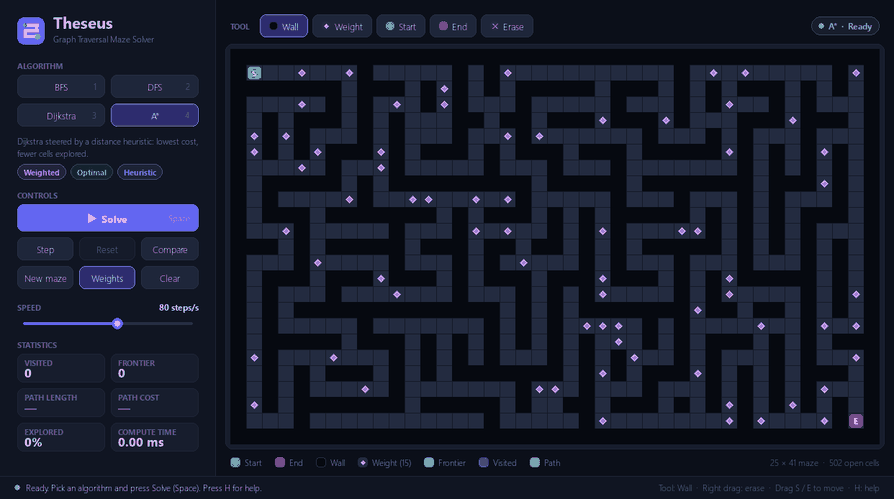
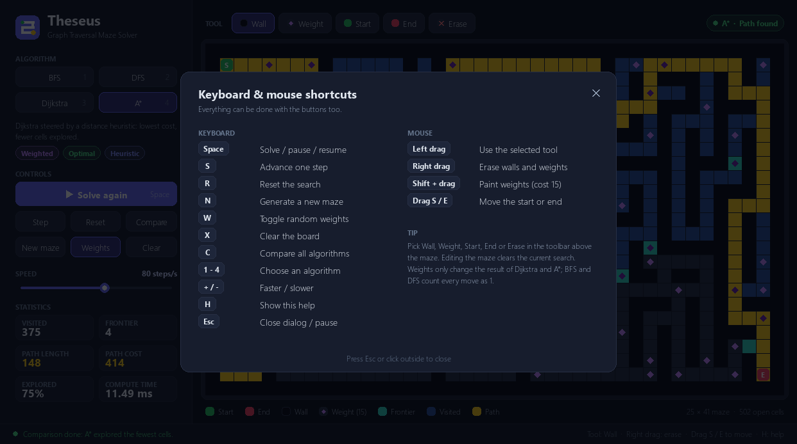
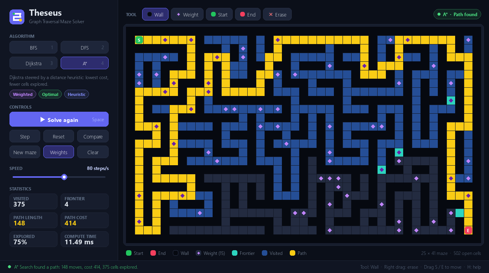
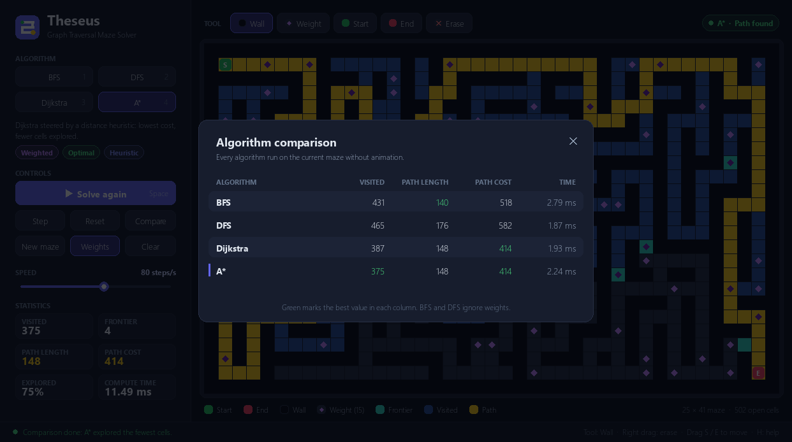
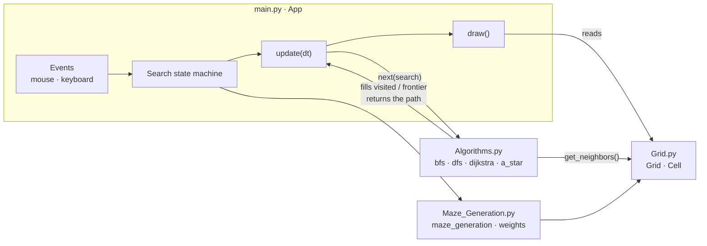
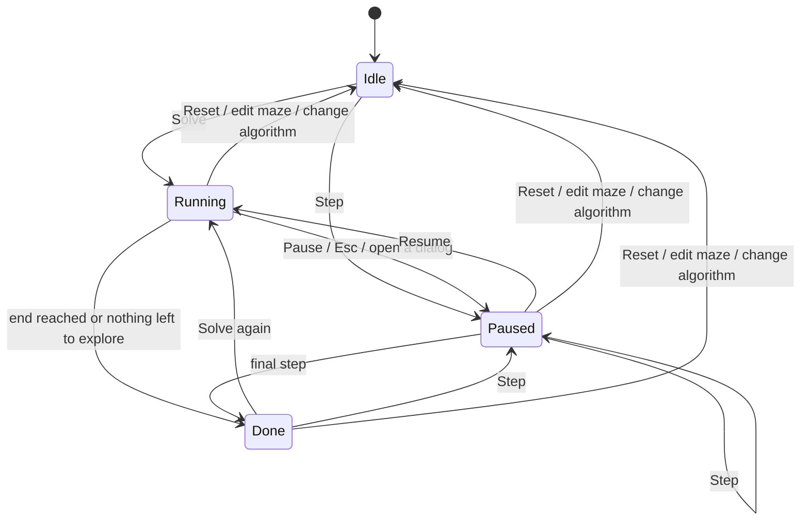

<div align="center">


# Theseus

### An interactive graph-traversal maze solver

Watch **BFS**, **DFS**, **Dijkstra** and **A\*** find their way through a maze you can generate, edit and weight, one step at a time.

[](https://www.python.org/)
[](https://pyga.me/)
[](#-algorithms)
[](#-quick-start)
[](#-quick-start)

[Features](#-features) ·
[Quick start](#-quick-start) ·
[Controls](#-controls) ·
[Algorithms](#-algorithms) ·
[How it works](#-how-it-works) ·
[Customisation](#-customisation)

<br>



<sub>A* on a weighted maze. Teal is the frontier, blue is visited, purple diamonds are expensive cells and yellow is the final path.</sub>

</div>

---

## Table of contents

- [Overview](#-overview)
- [Features](#-features)
- [Quick start](#-quick-start)
- [Controls](#-controls)
- [Interface tour](#-interface-tour)
- [Algorithms](#-algorithms)
- [How it works](#-how-it-works)
  - [Architecture](#architecture)
  - [Project structure](#project-structure)
  - [Algorithms as generators](#algorithms-as-generators)
  - [The grid model](#the-grid-model)
  - [Maze generation](#maze-generation)
  - [Weights and path cost](#weights-and-path-cost)
  - [Path reconstruction](#path-reconstruction)
  - [The main loop and animation](#the-main-loop-and-animation)
  - [Search state machine](#search-state-machine)
  - [Error handling](#error-handling)
- [Customisation](#-customisation)
- [Using the modules without the GUI](#-using-the-modules-without-the-gui)
- [Roadmap](#-roadmap)
- [Why "Theseus"?](#-why-theseus)
- [Author](#-author)

---

## 🧭 Overview

Path-finding algorithms are usually explained with static diagrams. **Theseus** makes them visible instead. It generates a random maze, treats every open cell as a node in a graph, and lets you watch each algorithm expand that graph cell by cell.

You can pause at any moment, step forward one expansion at a time, draw your own walls, add expensive cells, move the start and end, and finally run every algorithm on the same maze to compare how many cells each explored, how long its path is and what that path costs.

It is built with Python and pygame. The only dependency is **pygame-ce**.

---

## ✨ Features

| | |
|---|---|
| 🧠 **Four classic algorithms** | Breadth-First Search, Depth-First Search, Dijkstra's algorithm and A* with a Manhattan-distance heuristic. |
| 🎬 **Step-by-step animation** | Ten speed levels, from 2 expanded cells per second up to *Instant*. Pause, resume or advance one step at a time. |
| 🧱 **Random maze generator** | An iterative depth-first backtracker carves a perfect maze, then knocks out about 8% of the separating walls so there are several routes to choose from. |
| ⚖️ **Weighted cells** | Toggle random weights, or paint them yourself. A weighted cell costs **15** to enter instead of 1, so you can see Dijkstra and A* route around them. |
| ✏️ **Live editing** | A toolbar above the maze with **Wall**, **Weight**, **Start**, **End** and **Erase** tools. You can also drag S and E directly. Fast mouse drags are interpolated, so they never leave gaps. |
| 📊 **Live statistics** | Visited cells, frontier size, path length, path cost, percentage of the maze explored and pure algorithm compute time. |
| 🏁 **Compare mode** | Runs every algorithm on the current maze and shows the results in a table, with the best value in each column highlighted. |
| 💬 **Helpful feedback** | A colour-coded status bar, a cell inspector under the mouse, and a built-in shortcut reference (press **H**). |
| 🖥️ **Polished window** | Dark theme, resizable and maximisable window, and sharp rendering on high-DPI Windows displays. |
| 🛡️ **Robust** | Errors are caught and reported in the UI instead of crashing the app. See [Error handling](#error-handling). |

---

## 🚀 Quick start

### Requirements

- **Python 3.9 or newer**
- **pygame-ce 2.x** (classic `pygame` 2.x works too)

### Install and run

```bash
git clone https://github.com/MonaDewidar/Theseus-A-Graph-Traversal-Maze-Solver.git
cd Theseus-A-Graph-Traversal-Maze-Solver
python -m pip install pygame-ce
python main.py
```

On **Windows** you can also use the Python launcher:

```powershell
py -m pip install pygame-ce
py main.py
```

### Troubleshooting

| Message or problem | What to do |
|---|---|
| `Theseus needs pygame to run.` | Install pygame-ce **for the same Python you run the app with**: `python -m pip install pygame-ce`. |
| It works with `py` but not with `python` (Windows) | They point to different Python installations. Install pygame-ce into the one you use, or run `py main.py`. |
| `pygame 2.0 or newer is required` | Upgrade with `python -m pip install --upgrade pygame-ce`. |
| `Could not open the Theseus window` | There is no desktop display (for example over SSH), or the graphics driver has a problem. Run from a normal desktop session, update the driver, or restart. |
| The window is too wide for the screen | Lower `CELL` in `main.py` (for example to `18`). You can also resize or maximise the window. |

---

## 🎮 Controls

### Keyboard

| Key | Action |
|---|---|
| <kbd>Space</kbd> | Solve, pause, resume, or solve again |
| <kbd>S</kbd> or <kbd>→</kbd> | Advance one step |
| <kbd>R</kbd> | Reset the search |
| <kbd>N</kbd> | Generate a new maze |
| <kbd>W</kbd> | Toggle random weights |
| <kbd>X</kbd> | Clear the board (empty grid with a solid border) |
| <kbd>C</kbd> | Compare all algorithms |
| <kbd>1</kbd> to <kbd>4</kbd> | Choose BFS, DFS, Dijkstra or A* |
| <kbd>+</kbd> / <kbd>−</kbd> or <kbd>↑</kbd> / <kbd>↓</kbd> | Faster / slower (the mouse wheel over the sidebar works too) |
| <kbd>H</kbd> or <kbd>F1</kbd> | Show the shortcut reference |
| <kbd>Esc</kbd> | Close a dialog, or pause a running search |
| <kbd>Ctrl</kbd> + <kbd>Q</kbd> | Quit |

### Mouse and editing tools

Pick a tool in the **toolbar above the maze**, then click or drag on the maze with the left mouse button:

| Tool | What the left mouse button does |
|---|---|
| ⬛ **Wall** *(default)* | Draws walls. If you start the drag on a wall, it erases walls instead. |
| 🔷 **Weight** | Makes cells cost 15 to enter. If you start on a weighted cell, it removes weights instead. |
| 🟩 **Start** | Puts the start on the cell you click. Clicking a wall opens that cell. |
| 🟥 **End** | Puts the end on the cell you click. Clicking a wall opens that cell. |
| ❌ **Erase** | Removes walls and weights. |

These shortcuts work whichever tool is selected:

| Gesture | Action |
|---|---|
| **Right drag** | Erase walls and weights |
| **Shift + left drag** | Paint weighted cells (or remove them, if you start on one) |
| **Drag S or E** | Move the start or the end |

While you hover over the maze, the outline takes the selected tool's colour. The Start and End tools also preview the letter, so you can see what a click will do.

> [!TIP]
> Editing the maze while a search is shown clears that search automatically, so the picture never mixes old results with a new maze.

<details>
<summary><b>Show the built-in shortcut screen</b></summary>
<br>

</details>

---

## 💻 Interface tour



**Sidebar (left)**

1. **Algorithm**: four buttons (shortcut number shown on each), a one-line description, and tags that tell you whether the algorithm uses weights and whether its result is optimal.
2. **Controls**: the main **Solve** button changes to *Pause*, *Resume* or *Solve again* depending on the state. Below it are **Step**, **Reset**, **Compare**, **New maze**, **Weights** (highlighted while weights are on) and **Clear**.
3. **Speed**: a slider with ten levels. The current rate is shown on the right.
4. **Statistics**: six live tiles.

| Statistic | Meaning |
|---|---|
| **Visited** | Cells the algorithm has fully expanded so far. |
| **Frontier** | Cells discovered but not yet expanded (the queue, stack or heap). |
| **Path length** | Number of moves from start to end. |
| **Path cost** | Sum of the weights of every cell entered. The start is free. |
| **Explored** | Visited cells as a percentage of all open cells. |
| **Compute time** | Time spent inside the algorithm only. Drawing and animation delays are excluded. |

**Maze area (right)**

- Above the maze, the **toolbar** (Wall, Weight, Start, End, Erase) chooses what the mouse does. A **status chip** on the right shows the algorithm and its state (*Ready*, *Running*, *Paused*, *Path found* or *No path*).
- The **maze** itself. Hovering a cell outlines it in the colour of the selected tool.
- Below the maze, a **legend** explains every colour, next to the maze size and the number of open cells.

**Status bar (bottom)**

- On the left, the latest message: green for success, amber for warnings, red for errors.
- On the right, a cell inspector (row, column and cost of the cell under the mouse), or quick hints when the mouse is elsewhere.

### Colour legend

| Colour | Meaning |
|---|---|
| 🟩 Green **S** | Start |
| 🟥 Red **E** | End |
| ⬛ Near-black | Wall |
| 🔷 Purple diamond | Weighted cell (cost 15) |
| 🟦 Teal | Frontier: discovered, waiting to be expanded |
| 🔵 Blue | Visited: already expanded |
| 🟨 Yellow | The final path, revealed from start to end |

---

## 🧠 Algorithms

The maze is a graph. Every open cell is a **node** and every pair of open cells that share an edge is connected. Movement is 4-directional (up, down, left, right). Entering a cell costs that cell's weight: **1** normally and **15** for weighted cells.

### At a glance

| | BFS | DFS | Dijkstra | A* |
|---|---|---|---|---|
| **Frontier structure** | FIFO queue (`deque`) | LIFO stack (`list`) | Min-heap ordered by cost *g* | Min-heap ordered by *f = g + h* |
| **Uses weights** | ❌ | ❌ | ✅ | ✅ |
| **Guarantee** | Fewest moves | None | Lowest cost | Lowest cost |
| **Time** | O(V + E) | O(V + E) | O((V + E) log V) | O((V + E) log V) worst case |
| **Space** | O(V) | O(V) | O(V) | O(V) |

*V* is the number of open cells. On a 4-connected grid *E ≤ 4V*, so every algorithm is close to linear in the size of the maze.

### Breadth-First Search: `bfs`

Explores the maze in rings. All cells one move away come first, then two moves away, and so on. Because of that order, the **first time it reaches the end, it has used the fewest possible moves**. It ignores weights, so on a weighted maze that route can be expensive.

*Implementation:* a `deque` is the queue. The `parents` dictionary doubles as the "already discovered" set, so no cell is queued twice.

### Depth-First Search: `dfs`

Follows one corridor as deep as it can and backtracks only at dead ends. It often reaches the end quickly, but the path it returns is usually long and winding, and it has **no optimality guarantee**.

*Implementation:* an explicit stack of `(cell, parent)` pairs, so there is no recursion and no risk of hitting Python's recursion limit. A cell is marked visited when it is popped, and its parent is recorded at that moment.

### Dijkstra's algorithm: `dijkstra`

Always expands the cell with the **lowest total cost from the start**. With non-negative weights, a cell's cost is final the moment it is removed from the heap, so the path to the end is the **cheapest possible**.

*Implementation:* Python's `heapq` has no "decrease-key", so the code uses **lazy deletion**: when a cheaper route is found, it pushes a new entry and skips stale entries when they are popped. Entries are `(cost, order, cell)`. The increasing `order` counter breaks ties, because `Cell` objects cannot be compared with `<`.

### A* search: `a_star`

Dijkstra with a sense of direction. It orders the heap by **f = g + h**, where *g* is the cost so far and *h* is the Manhattan distance to the end.

- **Admissible:** every move costs at least 1, and you need at least *|Δrow| + |Δcol|* moves, so *h* never overestimates. A* therefore still finds the **cheapest path**.
- **Consistent:** *h* changes by exactly 1 per move and a move costs at least 1. Once a cell is expanded its cost is final, so the "skip if visited" rule is safe.

Because it prefers cells that move toward the goal, A* usually **expands far fewer cells** than Dijkstra for the same result. Heap entries are `(f, h, order, cell)`: on equal *f*, the cell closer to the end wins.

### Reading a comparison



On the weighted maze above:

- **BFS** found the route with the fewest moves (**140**), but walked through expensive cells and paid **518**.
- **DFS** found *a* route (176 moves, cost 582). It is valid, but neither short nor cheap.
- **Dijkstra** and **A\*** both found the cheapest route (cost **414**), which is slightly longer (148 moves) because it goes around weighted cells.
- **A\*** reached the same optimal answer while expanding the fewest cells (**375** vs 387), thanks to its heuristic.

Mazes are random, so your numbers will differ, but the pattern is the same.

---

## 🧩 How it works

### Architecture



The modules are deliberately independent:

- **`Grid.py`** knows nothing about drawing or algorithms.
- **`Algorithms.py`** and **`Maze_Generation.py`** only depend on the grid.
- **`main.py`** is the only file that imports pygame.

This separation means the algorithms can run and be tested without opening a window (see [Using the modules without the GUI](#-using-the-modules-without-the-gui)).

### Project structure

```text
Theseus/
├── main.py               # pygame GUI: layout, widgets, events, rendering, overlays
├── Algorithms.py         # bfs, dfs, dijkstra, a_star, build_path, path_cost, ALGORITHMS
├── Grid.py               # Cell and Grid: the data model
├── Maze_Generation.py    # maze carving, loop openings, random weights
├── docs/                 # logo, screenshots and demo GIF used by this README
└── README.md
```

### Algorithms as generators

This is the central design decision. Every algorithm is a **Python generator** with the same signature:

```python
def bfs(grid, visited, frontier):
    ...
    while queue:
        current = queue.popleft()
        frontier.discard(current)
        visited.add(current)
        if current is end:
            break
        for neighbor in grid.get_neighbors(current):
            ...
        yield                            # hand control back to the GUI
    return build_path(parents, end)      # delivered as StopIteration.value
```

- The algorithm **fills the `visited` and `frontier` sets it is given**. The GUI reads those same sets every frame to colour the cells.
- It **`yield`s once per expanded cell**. The GUI decides how many steps to run per frame, which is how speed control, pausing and single-stepping work.
- When it finishes it **`return`s the path**. Python delivers that value in `StopIteration.value`, and it is an empty list if the end is unreachable.

Driving a search therefore looks like this:

```python
search = ALGORITHMS["A*"](grid, visited, frontier)
try:
    while True:
        next(search)                     # one expansion
except StopIteration as finished:
    path = finished.value                # [] when there is no path
```

**Why generators?** The algorithm code reads exactly like the textbook version, with no callbacks, threads or locks. Each algorithm keeps its own state between steps, and cancelling a search is just `search.close()`.

### The grid model

`Cell` is a small object with `__slots__ = ("row", "col", "is_wall", "weight")`. There is exactly one `Cell` per position, so the default identity-based hashing is all the sets and dictionaries need.

| `Grid` method | Purpose |
|---|---|
| `Grid(rows, cols)` | Builds the grid. Raises `TypeError` / `ValueError` for non-integer sizes or anything smaller than 5 × 5. |
| `is_valid(row, col)` | Is the position inside the grid? |
| `is_interior(row, col)` | Inside the grid and not on the outer border? |
| `get_cell(row, col)` | The `Cell` at that position, or `None`. |
| `get_neighbors(cell)` | The (up to four) walkable neighbours. |
| `get_all()` | A generator over every cell, row by row. |
| `set_start(cell)` / `set_end(cell)` | Move an endpoint. Refuses walls and the other endpoint. |
| `clear()` | Empty board with a solid border. |
| `has_weights()` | Does any cell cost more than 1? |

### Maze generation

`maze_generation(grid, extra=0.08)` works in four stages:

1. **Fill** every cell with wall and reset all weights.
2. **Carve** with an *iterative* depth-first backtracker. It starts at `(1, 1)` and works only on odd coordinates. At each step it picks a random unvisited cell two steps away, opens that cell and the wall between, and pushes it. When it is stuck, it pops (backtracks). The result is a **perfect maze**: a spanning tree with exactly one route between any two cells.
3. **Add loops.** Every wall that separates two corridors, in exactly one direction, is opened with probability `extra`. Without this step every algorithm would find the same single route, and the comparison would be pointless.
4. **Place the endpoints.** The start goes at `(1, 1)` and the end at the bottom-right-most odd interior cell, which is always carved, even on grids with even dimensions.

An explicit stack is used instead of recursion, so large mazes cannot overflow Python's recursion limit.

### Weights and path cost

`add_random_weights(grid, chance=0.15, weight=15)` gives about 15% of open cells (never the start or end) a cost of 15. A weight is the cost of **entering** a cell, so:

```python
def path_cost(path):
    return sum(cell.weight for cell in path[1:])   # the start cell is free
```

BFS and DFS ignore weights entirely. Dijkstra and A* minimise this exact quantity.

### Path reconstruction

Each algorithm records, for every discovered cell, **which cell it came from** (`parents[cell]`). When the end is reached, `build_path` follows those links backwards from the end to the start, then reverses the list. If the end was never discovered it returns `[]`.

### The main loop and animation

The app runs a classic game loop at **60 FPS**: handle events, then `update(dt)`, then `draw()`.

- **Frame-rate-independent speed.** Each speed level is a number of *steps per second*. Every frame adds `dt × speed` to a *step budget* and runs the whole-number part of it. The budget is capped, and `dt` is limited to 0.1 s, so a stall (for example while the window is being dragged on Windows) cannot cause a sudden burst of steps.
- **Path reveal.** When a search ends, the path is drawn from start to end at `max(45, length / 1.2)` cells per second, so long paths still finish in about a second.
- **Text cache.** Rendered text surfaces are cached, so labels are not rasterised again every frame.
- **Window.** It is created with `SCALED | RESIZABLE`, so it can be resized or maximised. On Windows the process is marked DPI-aware so text stays sharp.

### Search state machine



The **Solve** button's label, the enabled state of **Step** and **Reset**, and the status chip all follow from this single state value.

### Error handling

| Situation | Behaviour |
|---|---|
| pygame is not installed | A clear install command is printed and the app exits with code 1. |
| pygame is older than 2.0 | A message asks you to upgrade. |
| A project file is missing | The message names the module that could not be loaded. |
| The window cannot be opened | The error is logged and the app exits with code 1. If scaling is unsupported it falls back to a fixed-size window. |
| No suitable system font | Falls back to pygame's built-in font. |
| An algorithm raises an exception | The search stops, the error appears in the status bar, the traceback goes to the console, and the app keeps running. |
| An algorithm fails during **Compare** | Only that row shows *Failed: …*. The other algorithms still run. |
| Maze generation fails | Falls back to an empty board and explains why. |
| The end is unreachable | The state becomes *No path* and the path tiles show *None*. |
| Editing the border, or drawing over S/E | Ignored, with a hint in the status bar. |
| Editing during a search | The search is reset automatically. |
| Invalid arguments (`Grid(3, 3)`, `extra=2`) | Clear `ValueError` / `TypeError` messages. |
| The window loses focus mid-drag | The drag is cancelled cleanly. |
| <kbd>Ctrl</kbd>+<kbd>C</kbd> in the terminal | Clean exit. |

---

## 🔧 Customisation

All tuning values are plain constants at the top of each file.

| Setting | Where | Default | Effect |
|---|---|---|---|
| `ROWS`, `COLS` | `main.py` | `25`, `41` | Maze size. Odd numbers give the cleanest mazes. |
| `CELL` | `main.py` | `22` | Size of one cell in pixels. |
| `FPS` | `main.py` | `60` | Frame-rate cap. |
| `SPEED_STEPS` | `main.py` | `2 … 640, None` | Steps per second for each slider level (`None` = instant). |
| `DEFAULT_SPEED` | `main.py` | `6` (80 steps/s) | Starting slider level. |
| `Color` | `main.py` | dark theme | Every colour in the UI. |
| `DEFAULT_WEIGHT` | `Maze_Generation.py` | `15` | Cost of a weighted cell. |
| `extra` | `maze_generation(...)` | `0.08` | Share of separating walls opened to create loops. |
| `chance` | `add_random_weights(...)` | `0.15` | Share of open cells that become weighted. |

The window size follows from these values:

- **width** = `340 + COLS × CELL`
- **height** = `max(112 + ROWS × CELL, 640) + 32`

The window never gets shorter than the sidebar needs. Keep `COLS × CELL` at about **620 or more** so the legend fits on one line.

### Adding your own algorithm

1. Write a generator with the same contract in `Algorithms.py`. For example, **Greedy Best-First Search**:

   ```python
   def greedy_best_first(grid, visited, frontier):
       """Greedy best-first search: always heads toward the end (fast, not optimal)."""
       start, end = grid.start, grid.end
       order = count()

       def heuristic(cell):
           return abs(cell.row - end.row) + abs(cell.col - end.col)

       parents = {start: None}
       heap = [(heuristic(start), next(order), start)]
       frontier.add(start)

       while heap:
           _, _, current = heapq.heappop(heap)
           if current in visited:
               continue
           frontier.discard(current)
           visited.add(current)
           if current is end:
               break
           for neighbor in grid.get_neighbors(current):
               if neighbor not in parents:
                   parents[neighbor] = current
                   heapq.heappush(heap, (heuristic(neighbor), next(order), neighbor))
                   frontier.add(neighbor)
           yield

       return build_path(parents, end)
   ```

2. Register it in the `ALGORITHMS` dictionary at the bottom of `Algorithms.py`:

   ```python
   ALGORITHMS = {
       "BFS": bfs,
       "DFS": dfs,
       "Dijkstra": dijkstra,
       "A*": a_star,
       "Greedy": greedy_best_first,
   }
   ```

3. *(Optional)* Give it a description and tags in `ALGO_INFO` in `main.py`:

   ```python
   "Greedy": AlgoInfo(
       "Greedy Best-First Search",
       "Always moves toward the end. Very fast, but the path is not guaranteed optimal.",
       (("Unweighted", Color.MUTED), ("Not optimal", Color.WARNING)),
   ),
   ```

The sidebar, number-key shortcuts (up to 9), Compare table and help screen all adapt automatically.

---

## 🐍 Using the modules without the GUI

The core modules do not import pygame, so you can use them in scripts, notebooks or tests:

```python
from Grid import Grid
from Maze_Generation import maze_generation, add_random_weights
from Algorithms import ALGORITHMS, path_cost

grid = Grid(21, 31)
maze_generation(grid)
add_random_weights(grid)

for name, algorithm in ALGORITHMS.items():
    visited, frontier = set(), set()
    search = algorithm(grid, visited, frontier)
    while True:
        try:
            next(search)
        except StopIteration as finished:
            path = finished.value
            break
    print(f"{name:<9} visited={len(visited):<4} moves={len(path) - 1:<4} cost={path_cost(path)}")
```

Example output (your maze will differ):

```text
BFS       visited=239  moves=60   cost=172
DFS       visited=171  moves=126  cost=322
Dijkstra  visited=262  moves=66   cost=164
A*        visited=231  moves=66   cost=164
```

---

## 📌 Roadmap

- [ ] Automated tests: path validity, Dijkstra and A* agreeing on cost, BFS matching Dijkstra on unweighted mazes
- [ ] Diagonal movement (8 neighbours) with an octile-distance heuristic
- [ ] More algorithms: Greedy Best-First, Bidirectional BFS, Jump Point Search
- [ ] More maze generators: Prim's, Kruskal's, recursive division
- [ ] Choose maze size and weight cost from the UI
- [ ] Save and load mazes as JSON
- [ ] Export a run as a GIF

---

## 📜 Why "Theseus"?

In Greek myth, **Theseus** entered the Labyrinth of Crete to face the Minotaur. He found his way back out by following the thread Ariadne gave him, unwinding it as he went.

Every algorithm here does the same thing. Each time it steps into a new cell, it records where it came from (`parents[cell]`). Once it reaches the end, it follows that thread back to the start, and that is the yellow path you see.

---

## 👤 Author

**Mona Dewidar** · [GitHub](https://github.com/MonaDewidar)

If you find this project useful, consider giving it a ⭐.
